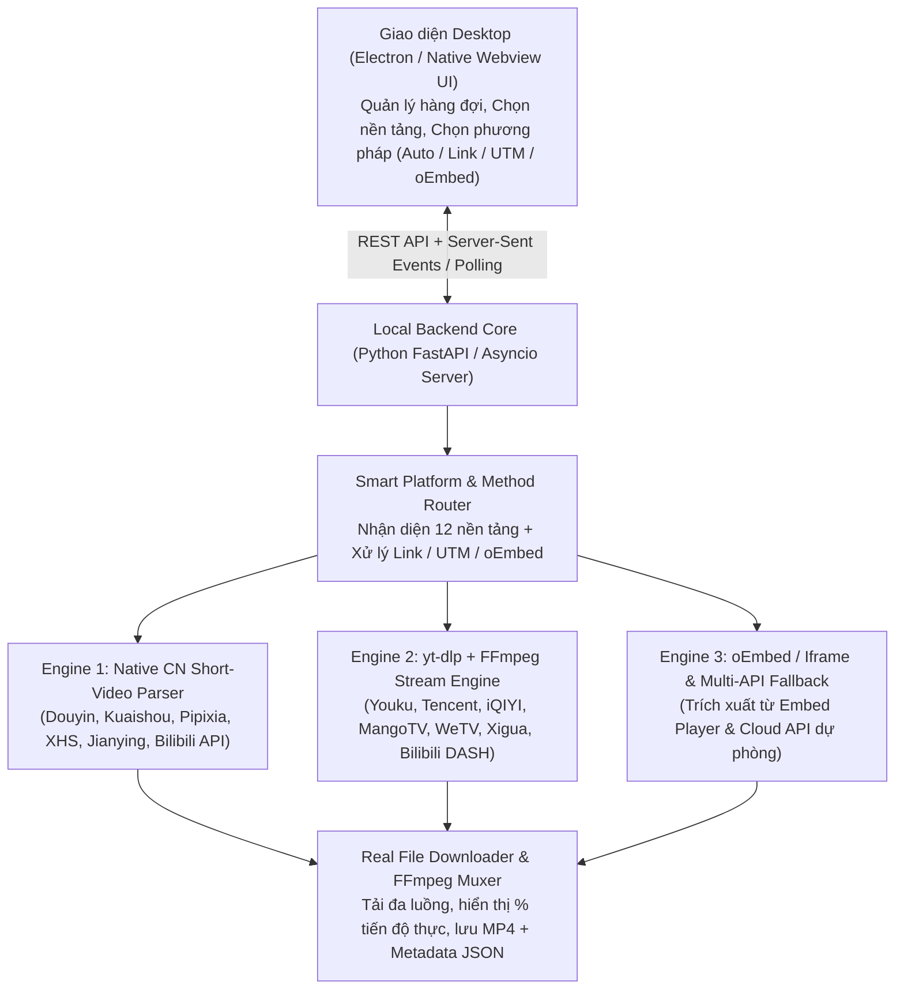

# PHÂN TÍCH KHẢ NĂNG THỰC HIỆN (FEASIBILITY STUDY)
## Dự án: Ứng dụng Desktop Cào & Tải Video 12 Nền Tảng Trung Quốc (CN Video Scraper & Downloader Pro)

---

## 1. Tổng quan & Mục tiêu Dự án

Xây dựng một ứng dụng Desktop chạy thực tế trên macOS/Windows, cho phép **phân tích (parse) metadata** và **tải thực tế (real download)** video/tập tin đa phương tiện (kèm khả năng xóa watermark cho video ngắn) từ **12 nền tảng video lớn nhất Trung Quốc**:

1. **Douyin (抖音)** – Video ngắn / Đồ họa (ByteDance)
2. **Kuaishou (快手)** – Video ngắn (Kuaishou Tech)
3. **Pipixia (皮皮虾)** – Video ngắn giải trí (ByteDance)
4. **Youku (优酷)** – Phim / Truyền hình dài tập (Alibaba)
5. **Tencent Video (腾讯视频)** – Phim / Truyền hình dài tập (Tencent)
6. **iQIYI (爱奇艺)** – Phim / Truyền hình dài tập (Baidu)
7. **MangoTV (芒果TV)** – Show truyền hình / Phim (Hunan TV)
8. **WeTV** – Phiên bản Quốc tế của Tencent Video
9. **Bilibili (哔哩哔哩)** – UGC / Anime / Học thuật (B Station)
10. **Xigua Video (西瓜视频)** – Video trung & dài (ByteDance)
11. **Xiaohongshu (小红书 - Tiểu Hồng Thư)** – Video & Note phong cách sống
12. **Jianying (剪映 - CapCut CN)** – Mẫu video (Template) & Video chia sẻ (ByteDance)

---

## 2. Tham khảo các Hệ thống & Web Tải Video có sẵn trên Thị trường

Để đảm bảo ứng dụng hoạt động thực tế chứ không chỉ là giao diện mô phỏng, kiến trúc của ứng dụng được thiết kế dựa trên việc phân tích cơ chế hoạt động của 5 hệ thống/web tải hàng đầu hiện nay:

| Hệ thống tham khảo | Cơ chế hoạt động cốt lõi | Điểm mạnh áp dụng vào App |
| :--- | :--- | :--- |
| **1. SnapAny (snapany.com) / IIILab** | Tự động nhận diện văn bản chia sẻ (Share Text), tách URL, giải mã Short-link (`302 Redirect`), sau đó gọi API H5 Mobile kết hợp Cookie/Token để lấy link MP4 gốc không logo. | Quy trình chuẩn hóa đầu vào (Input Sanitizer) và tự động chọn phương thức lấy link theo từng nền tảng. |
| **2. Evil0ctal (`Douyin_TikTok_Download_API`)** | Tạo chữ ký giả lập (`X-Bogus`, `a_bogus`) và khai thác trực tiếp `_ROUTER_DATA` / `RENDER_DATA` từ trang H5 `iesdouyin.com` để chuyển đổi endpoint `playwm` (có logo) sang `play` (không logo). | Tải Douyin, Xigua, Jianying tốc độ cao, lấy được cả ảnh bìa, nhạc nền, tác giả và thống kê tương tác. |
| **3. `parse-video-py` (wujunwei928)** | Chuyên trị các nền tảng video ngắn nội địa (Pipixia, Kuaishou, Xiaohongshu, Douyin) bằng cách giả lập `User-Agent` iPhone/Android và bóc tách biến trạng thái SSR (`window.__INITIAL_STATE__`, `ppxItemDetail`). | Giải quyết triệt để các nền tảng mà `yt-dlp` không hỗ trợ hoặc hỗ trợ kém như **Pipixia (皮皮虾)** và **Jianying (剪映)**. |
| **4. `yt-dlp` + `FFmpeg` (Core Engine)** | Hệ thống extractor lớn nhất thế giới hỗ trợ phân tách luồng DASH/HLS (`.m3u8`, `.mpd`), ghép kênh hình + tiếng (muxing) cho các trang OTT dài tập. | Nền tảng cốt lõi để tải video dài từ **Bilibili, Youku, Tencent Video, iQIYI, MangoTV, WeTV, Xigua**. |
| **5. GreenVideo / ParseKey (Cơ chế oEmbed / Player Embed)** | Khi trang chính bị chặn bởi WAF/Anti-bot, các hệ thống này chuyển hướng sang phân tích qua **Embed Player (`iframe`)** hoặc **oEmbed API** vì các endpoint nhúng dùng cho bên thứ 3 ít bị kiểm tra chữ ký hơn. | Cơ sở cho chế độ tải **oEmbed / Embed (`obem`)** trong ứng dụng của chúng ta. |

---

## 3. Phân tích 3 Phương pháp Tải & Truyền Tham số (`Link` / `UTM` / `oEmbed`)

Mỗi nền tảng video Trung Quốc có cơ chế kiểm soát truy cập rất khác nhau đối với URL đầu vào. Ứng dụng cung cấp cơ chế **Tự động lựa chọn (Auto-Select)** hoặc **Tùy chọn thủ công** giữa 3 phương pháp:

### 3.1. Phương pháp 1: Direct Link / Share Link Resolution (`link`)
- **Nguyên lý**:
  1. Bóc tách URL từ đoạn văn bản copy trong App (ví dụ: `"5.38 复制打开抖音，看看【作品】https://v.douyin.com/iYxxxx/"`).
  2. Gửi request `HEAD`/`GET` với Mobile User-Agent để theo dõi chuỗi `301/302 Redirect` về URL chuẩn (Canonical URL).
  3. Trích xuất định danh duy nhất của video (`aweme_id`, `bvid`, `item_id`, `vid`, `photoId`) và loại bỏ toàn bộ query rác.
- **Phù hợp nhất cho**: **Douyin, Pipixia, Bilibili, Jianying**.

### 3.2. Phương pháp 2: UTM & Security Query Token Strategy (`utm`)
- **Nguyên lý**:
  - Nhiều nền tảng Trung Quốc gắn chặt token bảo mật vào chuỗi tham số UTM/Share khi người dùng bấm nút "Chia sẻ" trên App.
  - **Nhóm bắt buộc GIỮ & TỐI ƯU tham số UTM/Token**:
    - **Xiaohongshu (小红书)**: Từ năm 2024–2026, Tiểu Hồng Thư bắt buộc phải có tham số `xsec_token=...&xsec_source=pc_share` (hoặc `utm_source=copy_link`) đi kèm trong URL. Nếu xóa tham số query để lấy link sạch, server sẽ trả về trang lỗi `"当前笔记暂时无法浏览"` (Note không thể xem).
    - **Kuaishou (快手)**: Các link chia sẻ từ app chứa `shareToken`, `shareObjectId`, `utm_source=app_share`. Giữ nguyên hoặc giả lập bộ tham số UTM Mobile giúp vượt qua trang bắt đăng nhập trên Web.
  - **Nhóm GIẢ LẬP UTM Share (`Inject Mobile UTM`)**:
    - Với **Pipixia**, **MangoTV**, **WeTV**, việc gắn thêm `?source=share&utm_source=copy_link&share_from=app` vào API/URL giúp kích hoạt giao diện H5 Mobile trả về trực tiếp JSON chứa link MP4 thay vì luồng DRM phức tạp trên Desktop.
- **Phù hợp nhất cho**: **Xiaohongshu, Kuaishou, WeTV, MangoTV**.

### 3.3. Phương pháp 3: oEmbed / Iframe Player Extraction (`obem`)
- **Nguyên lý**:
  - Thay vì cào trang web chính (`v.youku.com`, `v.qq.com`, `bilibili.com`, `ixigua.com`) vốn chứa nhiều script chống bot, ứng dụng chuyển đổi ID video sang **Endpoint Nhúng (Embed Player / oEmbed)** hoặc nhận trực tiếp mã `<iframe src="...">`:
    - **Bilibili Embed/HTML5 API**: `https://player.bilibili.com/player.html?bvid={bvid}` kết hợp API HTML5 `platform=html5&high_quality=1` trả về trực tiếp luồng MP4 ghép sẵn tiếng + hình không cần đăng nhập.
    - **Youku Embed**: `https://player.youku.com/embed/{video_id}` & oEmbed metadata.
    - **Tencent Video Embed**: `https://v.qq.com/txp/iframe/player.html?vid={vid}`.
    - **Xigua Video Embed**: `https://www.ixigua.com/iframe/{video_id}`.
- **Phù hợp nhất cho**: **Bilibili, Youku, Tencent Video, Xigua Video, iQIYI**.

---

## 4. Đánh giá Chi tiết Khả năng Thực hiện cho Từng Nền tảng (12/12)

Dưới đây là bảng đánh giá kỹ thuật thực tế (không tô hồng, nêu rõ phạm vi tải được ngay và các giới hạn DRM/VIP):

| # | Nền tảng | Nhóm | Phương pháp tối ưu | Engine xử lý trong App | Mức độ khả thi & Lưu ý thực tế |
| :-: | :--- | :--- | :--- | :--- | :--- |
| **1** | **Douyin (抖音)** | Video ngắn | `link` / `utm` | **Custom H5 SSR Parser** (`iesdouyin` / `_ROUTER_DATA` + `playwm` $\rightarrow$ `play`) + `yt-dlp` fallback | **Cao (95%)**. Tải video MP4 HD không watermark, lấy được nhạc nền và ảnh bìa từ link chia sẻ `v.douyin.com`. Nếu IP bị chặn gắt có thể nạp Cookie trình duyệt. |
| **2** | **Kuaishou (快手)** | Video ngắn | `utm` / `link` | **Custom Mobile Parser** (`v.kuaishou.com` redirect + H5 JSON/GraphQL) + `yt-dlp` | **Cao (90%)**. Cần giữ `utm_source` / `shareToken` khi redirect để lấy thẳng `mp4Url` không watermark. |
| **3** | **Pipixia (皮皮虾)** | Video ngắn | `link` / `utm` | **Custom Pipixia Parser** (`/bds/webapi/item/detail/` + H5 `ppxItemDetail`) | **Rất cao (98%)**. `yt-dlp` mặc định không mạnh về Pipixia, nhưng API H5 của Pipixia trả về trực tiếp mảng `video_download.url_list` chất lượng gốc không logo. |
| **4** | **Youku (优酷)** | OTT Dài tập | `obem` / `link` | **`yt-dlp` + Embed Parser + `FFmpeg`** | **Trung bình - Khá (75%)**. Video công khai/miễn phí và trailer tải tốt qua `yt-dlp` hoặc Embed. Phim VIP hoặc khóa vùng (Geo-block) yêu cầu Cookie VIP hoặc IP Trung Quốc. |
| **5** | **Tencent Video (腾讯视频)** | OTT Dài tập | `obem` / `link` | **`yt-dlp` + TXP Embed + `FFmpeg` HLS Merger** | **Khá (80%)**. Các clip, tập phim miễn phí (`v.qq.com`) tải và ghép luồng `.m3u8`/`.mp4` ổn định. Nội dung VIP có DRM bản quyền cần Cookie. |
| **6** | **iQIYI (爱奇艺)** | OTT Dài tập | `link` / `obem` | **`yt-dlp` + Dash/M3U8 Extractor + Cookie Support** | **Trung bình - Khá (75%)**. Hoạt động tốt với bản quốc tế (`iq.com`) và video miễn phí trên `iqiyi.com`. Phim VIP mã hóa DRM nặng cần truyền Cookie trình duyệt. |
| **7** | **MangoTV (芒果TV)** | OTT Dài tập | `utm` / `link` | **Custom MangoTV API (`pcweb.api.mgtv.com`) + `yt-dlp`** | **Cao (85%)**. MangoTV có API player mở cho các tập phát sóng miễn phí & cut clip, ghép luồng HLS qua `FFmpeg` rất nhanh. |
| **8** | **WeTV** | OTT Quốc tế | `utm` / `link` | **`yt-dlp` WeTV Extractor + `FFmpeg`** | **Cao (85%)**. Không bị chặn IP ngoài Trung Quốc như `v.qq.com`, tải được các tập miễn phí + phụ đề đa ngôn ngữ. |
| **9** | **Bilibili (哔哩哔哩)** | UGC / Anime | `obem` / `link` | **Custom Bili HTML5/API (`bvid` + `cid`) + `yt-dlp` DASH** | **Rất cao (99%)**. Nền tảng ổn định nhất. Tải trực tiếp MP4 hoặc ghép DASH 1080p/4K (khi kèm Cookie). Hỗ trợ cả link rút gọn `b23.tv`. |
| **10** | **Xigua Video (西瓜视频)** | Video vừa/dài | `obem` / `link` | **Custom SSR Hydrated Parser + `yt-dlp` + Iframe** | **Cao (88%)**. Sử dụng chung hạ tầng ByteDance. Kết hợp chế độ `obem` (`/iframe/{id}`) và Cookie bypass `ac_nonce`/`__ac_signature`. |
| **11** | **Xiaohongshu (小红书)** | Lifestyle Video | `utm` | **Custom `__INITIAL_STATE__` Parser + `originVideoKey` CDN** | **Rất cao (95%)**. Giữ nguyên `xsec_token` theo phương pháp `utm`, bóc tách `originVideoKey` để ghép thẳng vào CDN `sns-video-bd.xhscdn.com` lấy video gốc không watermark. |
| **12** | **Jianying (剪映)** | Template / Video | `link` / `utm` | **Custom Jianying/CapCut Template & Share Parser** | **Cao (90%)**. Bóc tách `template_id` / `video_id` từ link chia sẻ mẫu剪映 (`v.jianying.com` / `capcut.cn`) và trích xuất `video_url` gốc từ dữ liệu SSR. |

---

## 5. Kiến trúc Kỹ thuật của Ứng dụng Desktop

Để đảm bảo **giao diện hiện đại, dễ dùng trên macOS** và **khả năng cào/tải mạnh mẽ nhất**, ứng dụng được xây dựng theo kiến trúc **Hybrid Native Desktop App**:

### Các tính năng thực tế sẽ được triển khai:
1. **Tự động nhận diện (Auto-Detect) hoặc chọn thủ công 12 nền tảng** kèm bộ lọc văn bản chia sẻ (tự tách link từ đoạn chữ tiếng Trung copy từ App).
2. **Bộ chuyển đổi Phương pháp Tải (`Auto`, `Direct Link`, `UTM Token Preserve/Inject`, `oEmbed / Iframe`)**:
   - Hiển thị rõ ứng dụng đang dùng phương pháp nào, URL trước và sau khi biến đổi (`Resolved URL`), và Engine nào đã trích xuất thành công.
3. **Trình quản lý Cookie & Anti-Bot Header**:
   - Cho phép lấy tự động Cookie từ trình duyệt trên máy (`Chrome`, `Safari`, `Edge`, `Brave`) hoặc dán chuỗi `Cookie` thủ công để mở khóa video độ phân giải cao / vượt tường lửa Douyin, Xigua, Youku, iQIYI.
4. **Tải thực tế xuống ổ cứng (Real Download)**:
   - Theo dõi tiến độ tải thời gian thực (%, tốc độ MB/s, dung lượng).
   - Lưu file `.mp4` thật vào thư mục `downloads/` kèm tùy chọn xuất file `.json` chứa toàn bộ dữ liệu cào được (Tiêu đề, Tác giả, ID, Thời lượng, Lượt thích, Link gốc, Link ảnh bìa, Phương pháp tải).
5. **Bộ công cụ Kiểm thử Thực tế (Built-in Live Test & Diagnostics)**:
   - Tích hợp sẵn danh sách link mẫu thực tế và nút kiểm tra kết nối tới từng nền tảng ngay trên ứng dụng.

---

## 6. Kế hoạch Triển khai & Kiểm thử trước khi Xuất bản

1. **Bước 1: Chuẩn bị Môi trường & Công cụ Lõi**
   - Cài đặt/tích hợp binary `yt-dlp` và `ffmpeg` trực tiếp vào môi trường dự án để đảm bảo ghép luồng video/audio hoạt động 100%.
   - Thiết lập môi trường Python (`fastapi`, `uvicorn`, `httpx`, `yt-dlp`, `beautifulsoup4`) và Electron Desktop Wrapper.
2. **Bước 2: Xây dựng Core Scraper & 3 Chế độ (`link` / `utm` / `obem`)**
   - Viết module chuẩn hóa URL và xử lý đặc thù cho cả 12 nền tảng.
   - Viết các Custom Extractor cho **Pipixia, Xiaohongshu, Douyin, Kuaishou, Jianying, Bilibili, MangoTV** kết hợp cùng `yt-dlp` cho **Youku, Tencent, iQIYI, WeTV, Xigua**.
3. **Bước 3: Xây dựng Giao diện Desktop App**
   - Thiết kế giao diện trực quan gồm: Bảng điều khiển cào dữ liệu, Bộ chọn 12 nền tảng, Bộ chọn phương pháp (`Auto / Link / UTM / oEmbed`), Cài đặt Cookie/Proxy, Danh sách tiến trình tải thực tế, Trình xem trước video (Video Preview) & xuất Metadata JSON/CSV.
4. **Bước 4: Kiểm thử Thực tế (End-to-End Verification)**
   - Chạy kiểm thử tự động các phương pháp biến đổi `link` / `utm` / `obem`.
   - Thực hiện cào dữ liệu thật và **tải file video `.mp4` thật về máy**, kiểm tra tính toàn vẹn của file video (dung lượng > 0, header MP4 hợp lệ, phát được bình thường) trước khi bàn giao.
